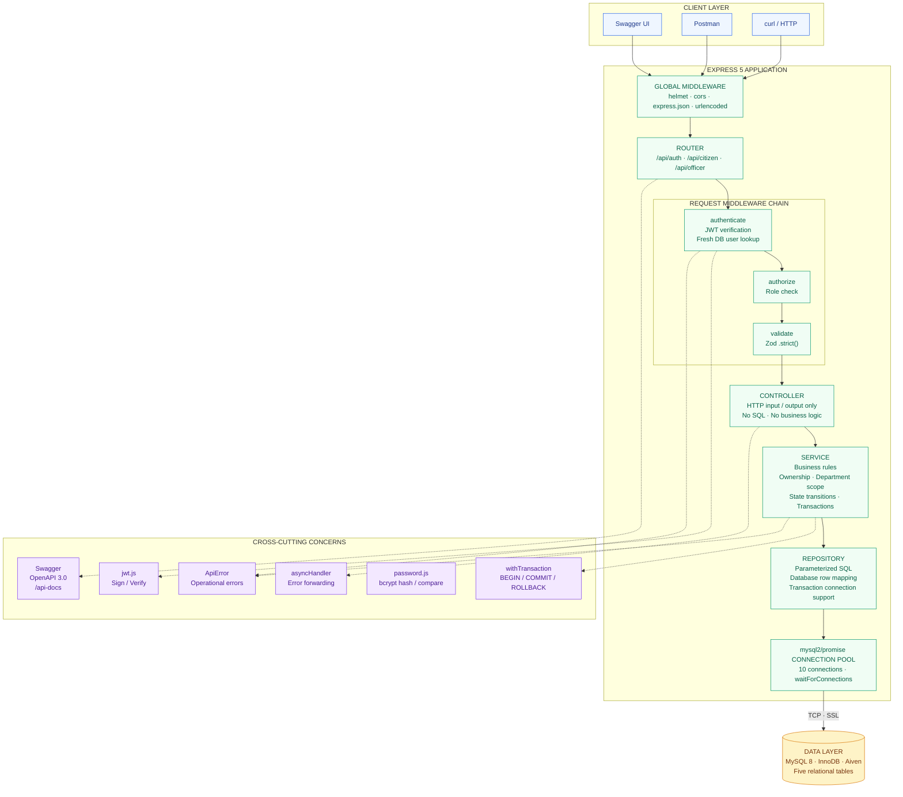
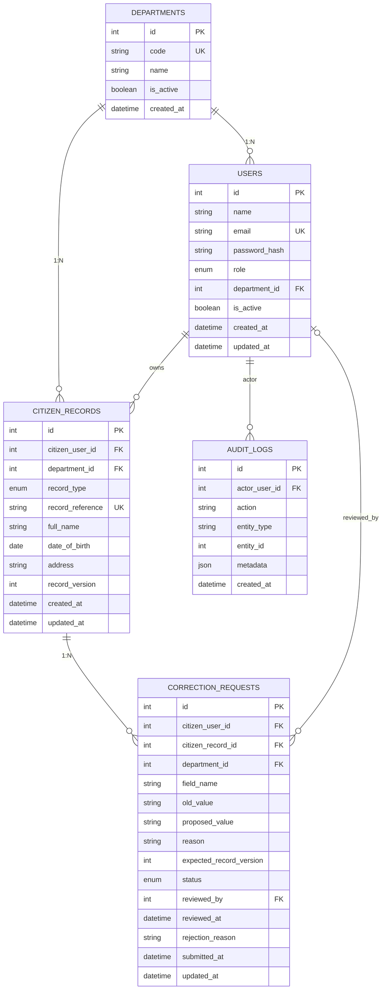

# CIMS — Citizen Information Management System

**A Backend-Focused Citizen Record Correction Prototype**

Built for **Credosis Phase 02 — From Idea to Demo** · Backend Engineer Intern Track

CIMS demonstrates one complete backend workflow: a citizen submits a correction request for one of their identity records, and an authorized department officer reviews and decides on it.

Everything runs on fictional data. No government API, no real NID, no production user data — just a focused backend that demonstrates how a correction workflow can be structured safely using transactions, validation, and audit logging.

**Stack:** Node.js · Express 5 · MySQL 8 · mysql2/promise · JWT · Zod · Swagger UI · Jest · Supertest

**Deployment:** Render (API) + Aiven (Managed MySQL)

---

## Quick Links

| Resource | Link |
|---|---|
| Live Swagger UI | [Explore API Documentation](https://citizen-information-management-system.onrender.com/api-docs) |
| API Base URL | [Production API](https://citizen-information-management-system.onrender.com) |
| Health Check | [Check API Health](https://citizen-information-management-system.onrender.com/api/health) |
| GitHub Repository | [Source Code](https://github.com/naeemsarker02/citizen-information-management-system) |
| Video Walkthrough | [Watch the walkthrough →](youtube link) |

**Video coverage:** The problem, live demo, technical decisions, and one thing I'd change if I started over.

> **Prototype notice:** CIMS is a recruitment-evaluation prototype. It is not an official government system and is not connected to any real government database or API.

---

## ⚡ Quick Start — Try It in 5 Minutes

The live API is ready. Open Swagger UI, log in, run the full workflow — no setup required.

**🔗 Live Swagger UI:** https://citizen-information-management-system.onrender.com/api-docs

**Password for every account:** `Demo@12345`

### All Demo Accounts (fictional, local-only)

**Citizens:**

| Name | Email | Records | Scenario |
|---|---|---|---|
| **Md. Rakib Hossain** | `citizen@example.com` | BR-1001 *(typo)*, NID-1001 | Fresh typo to correct |
| **Fatima Akter** | `fatima@example.com` | BR-1002 *(typo)*, NID-1002 | Has a pending request for officer review |
| **Mohammad Tanvir Ahmed** | `tanvir@example.com` | BR-1003 *(corrected)*, NID-1003 | Already-corrected history |
| **Sadia Islam** | `sadia@example.com` | BR-1004, NID-1004 | Clean records (baseline) |

**Officers:**

| Name | Email | Department |
|---|---|---|
| **Birth Officer** | `officer.birth@example.com` | Birth Registration |
| **Rafiq Uddin** | `officer.rafiq@example.com` | Birth Registration |
| **NID Officer** | `officer.nid@example.com` | NID |
| **Abdur Rahman** | `officer.rahman@example.com` | NID |

### Three Quick Tests

**Test 1 — Approve a pending request (~60 sec)**

1. Login as `officer.rafiq@example.com` → copy token → **Authorize**
2. `GET /officer/correction-requests?status=PENDING` → sees Fatima's pending BR-1002
3. `PATCH /officer/correction-requests/{id}/decision` with `{"decision": "APPROVED"}`
4. Login as `fatima@example.com` → `GET /citizen/records` → BR-1002 now shows `"Fatima Akter"`, version `2`

**Test 2 — Fresh correction (~90 sec)**

1. Login as `citizen@example.com` → `GET /citizen/records` → see BR-1001 with typo `"Md. Rakib Hasan"`
2. `POST /citizen/records/BR-1001/correction-requests` with:
   ```json
   {
     "changes": [{"fieldName": "full_name", "proposedValue": "Md. Rakib Hossain"}],
     "reason": "Surname spelling correction — align with NID"
   }
   ```
3. Login as `officer.birth@example.com` → `PATCH .../decision` with `{"decision": "APPROVED"}`
4. Login back as `citizen@example.com` → `GET /citizen/records` → BR-1001 now shows `"Md. Rakib Hossain"`, version `2`

**Test 3 — Try to break the workflow (~60 sec)**

1. Login as `tanvir@example.com` → try to access Fatima's record: `GET /citizen/records/BR-1002` → **`403 NOT_RECORD_OWNER`**
2. Try an officer endpoint: `GET /officer/correction-requests` → **`403 FORBIDDEN`**
3. Login as `officer.birth@example.com` → try to approve an NID request → **`403 WRONG_DEPARTMENT`**
4. Approve a request that's already approved → **`409 REQUEST_ALREADY_PROCESSED`**

### What each account demonstrates

- **Rakib** — the main "before" scenario: typo exists, ready to fix
- **Fatima** — historical pending request; officer approval queued
- **Tanvir** — historical approved + rejected requests; shows audit trail
- **Sadia** — clean baseline; no corrections needed
- **Birth Officer** / **Rafiq** — see Birth Registration department requests only
- **NID Officer** / **Abdur Rahman** — see NID department requests only

---

## Table of Contents

1. [Project Overview](#1-project-overview)
2. [Why I Built This](#2-why-i-built-this)
3. [What This Prototype Actually Does](#3-what-this-prototype-actually-does)
4. [What's Deliberately Out of Scope](#4-whats-deliberately-out-of-scope)
5. [System Architecture](#5-system-architecture)
6. [Data Flow — Correction Request Lifecycle](#6-data-flow--correction-request-lifecycle)
7. [Database Schema](#7-database-schema)
8. [Key Engineering Decisions](#8-key-engineering-decisions)
9. [Security and API Response Handling](#9-security-and-api-response-handling)
10. [Running It Locally](#10-running-it-locally)
11. [Demo Accounts](#11-demo-accounts)
12. [API Reference](#12-api-reference)
13. [Try It in Swagger](#13-try-it-in-swagger)
14. [Tests](#14-tests)
15. [Reset Modes](#15-reset-modes)
16. [A Few Things Worth Knowing](#16-a-few-things-worth-knowing)
17. [Known Limitations](#17-known-limitations)
18. [If This Grew Up](#18-if-this-grew-up)
19. [Repository Structure](#19-repository-structure)
20. [About This Project](#20-about-this-project)

---

# 1. Project Overview

CIMS (Citizen Information Management System) is a backend prototype built for **Credosis Phase 02 — From Idea to Demo** (Backend Engineer Intern track).

It demonstrates one workflow end-to-end:

**Citizen submits a correction request → Department officer reviews and decides → Citizen verifies the result.**

The scope is deliberately focused on implementing a correction workflow with proper transactions, validation, authorization, relational integrity, concurrency protection, and audit logging.

### Project Information

| Property | Details |
|---|---|
| Project | Citizen Information Management System (CIMS) |
| Project Type | Backend REST API Prototype |
| Architecture | Modular Monolith · Layered Architecture |
| Runtime | Node.js |
| Framework | Express 5 |
| Database | MySQL 8 · InnoDB |
| Driver | mysql2/promise |
| Authentication | JWT |
| Validation | Zod |
| API Documentation | Swagger / OpenAPI 3.0 |
| Testing | Jest + Supertest |
| API Hosting | Render |
| Database Hosting | Aiven Managed MySQL |

---

# 2. Why I Built This

In Bangladesh — and in most places — a person's identity information lives in more than one place.

Your name on the birth registration might not match your name on the NID. Your father's spelling might differ across documents. Fixing that is not one office trip; it's a chain of them, each with its own form, its own queue, its own status check.

The real pain isn't that the information is wrong. It's that:

- The citizen has no single place to see all their records side by side.
- There's no transparent way to ask for a correction and track it.
- Different departments process corrections independently, so nobody can prove who changed what, when, and on what basis.

CIMS explores what a coordinated version of that could look like.

It's a **coordination layer** — not a replacement for any government system.

The prototype focuses on the piece that's most instructive to build: the correction request lifecycle, from submission to decision, with everything traceable.

### Fictional Example

| Document | Recorded Name |
|---|---|
| Birth Registration | Md. Rakib Hasan *(typo)* |
| National ID (NID) | Md. Rakib Hossain |

The whole point is to let the citizen ask for `Md. Rakib Hasan` to become `Md. Rakib Hossain` through a reviewed, audited process — not by editing a database row directly.

---

# 3. What This Prototype Actually Does

Following Credosis's guidance that a full MVP is not required, the scope is deliberately tight.

## Core Feature — Correction Request Lifecycle

- A citizen submits a correction request against one of their own records → status `PENDING`.
- The responsible department's officer retrieves the request (scoped to their department only).
- The officer approves (record updated, version bumped) or rejects (reason stored, record untouched).
- Both the decision and the audit entry commit in a single transaction.

## Supporting Features

**1. Authentication + Role-Based Access**

- JWT login.
- `CITIZEN` and `OFFICER` roles.
- A fresh DB lookup on every protected request so a deactivated user or inactive department is caught immediately.

**2. Record Retrieval**

- Citizens can list their own records.
- Ownership is checked server-side, not just filtered in a query.

**3. Request Tracking**

- Citizens see their own request history and current status.
- Other users see nothing.

## Quality Features

These make the prototype feel like real backend code, not just a CRUD demo:

- Zod schemas with `.strict()` on every object — unknown or spoofed keys return `400`, not silently stripped.
- Consistent error envelope: `{ success: false, error: { code, message } }` across every endpoint.
- Append-only audit log written in the same transaction as the action it describes — if the action fails, the audit fails with it.
- Optimistic concurrency via `expected_record_version` — a stale approval can't overwrite fresh data.
- Interactive OpenAPI docs at `/api-docs`.
- Jest + Supertest tests for auth, records, and the full correction lifecycle.

---

# 4. What's Deliberately Out of Scope

Real government integration. Registration flows. Document uploads. OCR or biometric verification. Email/SMS notifications. Multi-level approval. Admin dashboards. Mobile apps. Microservices, Redis, Kafka.

None of these are missing by accident. They're missing because a four-day prototype with one meaningful workflow is worth more than a shallow attempt at twelve.

The demo also doesn't include a frontend — Swagger UI is the interface. Reviewers can authenticate, execute every endpoint, and run the full workflow interactively without touching code.

---

# 5. System Architecture

The codebase is a **modular monolith with layered architecture**. Each layer owns one job and knows nothing about the layer above it.

## Architecture Diagram



## Layer Responsibilities

| Layer | Responsibility |
|---|---|
| HTTP Clients | Swagger UI, Postman, curl |
| Global Middleware | helmet, cors, JSON and URL-encoded parsing |
| Router | `/api/auth`, `/api/citizen`, `/api/officer` |
| Request Middleware | Authentication, authorization and validation |
| Controller | HTTP input/output only |
| Service | Business rules, ownership, transactions and state transitions |
| Repository | Parameterized SQL and database row mapping |
| Connection Pool | MySQL connections through mysql2/promise |
| Data Layer | MySQL 8 with InnoDB |

## Three Rules Enforced Throughout

1. **Controllers never write SQL. Services never touch `req`/`res`. Repositories never decide HTTP status codes.** If a decision felt like it belonged to two layers, the layer boundary made the call.

2. **Business logic that depends on a DB read** (ownership, duplicate checks, version comparison) always happens **inside the service**, using data the repository returned. The check and the action live in the same code path — not spread across middleware and controller.

3. **Every DB write inside a transaction uses the transaction's connection.** If a helper needs a connection, it takes it as a parameter. No silent fallbacks to the pool.

---

# 6. Data Flow — Correction Request Lifecycle

A single correction request passes through three phases.

The key design principle:

**The client provides intent (what to change and why); the server derives all state (who owns the record, what the old value is, and what the expected version is).**

## End-to-End Lifecycle Diagram

```mermaid
flowchart TB

    subgraph PHASE1["PHASE 1 — CITIZEN SUBMITS"]
        direction TB

        C1["Citizen submits<br/>POST /api/citizen/records/BR-1001/correction-requests<br/>{ changes, reason } + JWT"]

        C2["authenticate<br/>JWT verification · Fresh DB user"]

        C3["authorize<br/>role === CITIZEN"]

        C4["validate<br/>Zod .strict() on params + body"]

        C5["Service — withTransaction()"]

        C1 --> C2 --> C3 --> C4 --> C5

        subgraph SUBMITTX["SUBMISSION TRANSACTION"]
            direction TB
            S1["BEGIN"]
            S2["LOCK citizen_records row<br/>SELECT ... FOR UPDATE"]
            S3["Verify ownership"]
            S4["No-op check<br/>proposed value ≠ current value"]
            S5["Duplicate check<br/>No PENDING request for same record + field"]
            S6["INSERT correction_requests<br/>status = PENDING"]
            S7["old_value ← record.full_name<br/>expected_record_version ← record.record_version"]
            S8["INSERT audit_logs<br/>REQUEST_SUBMITTED"]
            S9["COMMIT"]

            S1 --> S2 --> S3 --> S4 --> S5 --> S6 --> S7 --> S8 --> S9
        end

        C5 --> S1
        S9 --> S10["201 CREATED<br/>{ request: { id, status: PENDING } }"]
    end

    subgraph PHASE2["PHASE 2 — OFFICER DECIDES"]
        direction TB

        O1["Officer retrieves request<br/>GET /api/officer/correction-requests"]

        O2["Officer submits decision<br/>PATCH /api/officer/correction-requests/:id/decision"]

        O3["authenticate → authorize(OFFICER) → validate"]

        O4["Service — withTransaction()"]

        O1 --> O2 --> O3 --> O4

        subgraph DECISIONTX["DECISION TRANSACTION"]
            direction TB
            D1["BEGIN"]
            D2["Non-locking read<br/>request.citizen_record_id"]
            D3["LOCK citizen_records — lock #1"]
            D4["LOCK correction_requests — lock #2"]
            D5["Verify status = PENDING"]
            D6["Verify department matches"]
            D7["Verify expected_record_version<br/>against current record version"]
            D8{"Decision?"}

            D9["APPROVE<br/>UPDATE citizen_records<br/>full_name + record_version + 1"]

            D10["UPDATE correction_requests<br/>APPROVED · reviewer · timestamp"]

            D11["REJECT<br/>Record remains unchanged"]

            D12["UPDATE correction_requests<br/>REJECTED · rejection_reason · reviewer"]

            D13["INSERT audit_logs<br/>REQUEST_APPROVED or REQUEST_REJECTED"]

            D14["COMMIT"]

            D1 --> D2 --> D3 --> D4 --> D5 --> D6 --> D7 --> D8

            D8 -->|"APPROVED"| D9 --> D10 --> D13
            D8 -->|"REJECTED"| D11 --> D12 --> D13

            D13 --> D14
        end

        O4 --> D1
        D14 --> O15["200 OK<br/>Decision recorded"]
    end

    subgraph PHASE3["PHASE 3 — CITIZEN VERIFIES"]
        direction TB

        V1["GET /api/citizen/correction-requests/1<br/>View status · reviewedBy · reviewedAt"]
        V2["GET /api/citizen/records<br/>Retrieve current record"]
        V3["Verify final result<br/>Record value · record_version"]
        V1 --> V2 --> V3
    end

    S10 --> O1
    O15 --> V1

    TXFAIL["ANY TRANSACTION FAILURE<br/>ROLLBACK<br/>Error handled by API error handler"]

    SUBMITTX -.-> TXFAIL
    DECISIONTX -.-> TXFAIL
```



## Phase 1 — Citizen Submits

**Endpoint:**

`POST /api/citizen/records/BR-1001/correction-requests`

**Example request body:**

```json
{
  "changes": [
    {
      "fieldName": "full_name",
      "proposedValue": "Md. Rakib Hossain"
    }
  ],
  "reason": "Name spelling correction"
}
```

### Submission workflow

1. Authenticate citizen using JWT.
2. Load the fresh user from the database.
3. Verify the `CITIZEN` role.
4. Validate route parameters and request body using Zod `.strict()`.
5. Start the transaction.
6. Lock the citizen record using `SELECT ... FOR UPDATE`.
7. Verify record ownership.
8. Perform no-op check (`proposed value ≠ current value`).
9. Check for an existing `PENDING` request for the same record and field.
10. Insert the correction request.
11. Insert the audit log using the same transaction connection.
12. Commit.

The following values come from the database, not the client:

| Value | Source |
|---|---|
| `old_value` | Existing citizen record |
| `expected_record_version` | Existing citizen record |
| `citizen_user_id` | Authenticated database user |
| `department_id` | Citizen record |
| `status` | Server default: `PENDING` |
| `timestamps` | Server / database |

**Response:** `201 Created`

```json
{
  "request": {
    "id": 1,
    "status": "PENDING"
  }
}
```

## Phase 2 — Officer Decides

**Endpoint:**

`PATCH /api/officer/correction-requests/1/decision`

**Example approval body:**

```json
{
  "decision": "APPROVED"
}
```

### Decision workflow

1. Authenticate the officer.
2. Verify the `OFFICER` role.
3. Validate the request.
4. Start a database transaction.
5. Perform a non-locking read of `request.citizen_record_id` to know which record to lock.
6. Lock `citizen_records` first.
7. Lock `correction_requests` second.
8. Verify `status = PENDING`.
9. Verify department authorization.
10. Compare `expected_record_version` with the current record version.
11. Apply approval or rejection.
12. Insert the corresponding audit entry.
13. Commit the transaction.

### Lock Ordering

Both approve and reject follow the same lock order:

```text
1. citizen_records
        ↓
2. correction_requests
```

**Uniform lock ordering:** Record first, request second.

This reduces deadlock risk when concurrent decisions occur.

### Approval

- Update the citizen record.
- Increment `record_version` by exactly one.
- Update correction request status to `APPROVED`.
- Store `reviewed_by` and `reviewed_at`.
- Insert an audit entry with action `REQUEST_APPROVED`.
- Commit all changes together.

### Version Conflict

If `expected_record_version` does not match the current version:

```text
409 RECORD_STATE_CONFLICT
```

The stale approval must not overwrite a newer record state.

### Rejection

- The citizen record is not modified.
- The correction request becomes `REJECTED`.
- The rejection reason is stored.
- Reviewer information and timestamp are recorded.
- An audit entry with action `REQUEST_REJECTED` is inserted.

**Important:** Rejection uses the same record-then-request lock order as approval, but it skips the version check because it does not modify the citizen record. This behavior is intentional and explained further in [Key Engineering Decisions](#16-a-few-things-worth-knowing).

## Phase 3 — Citizen Verifies

**Request status:**

`GET /api/citizen/correction-requests/1`

Returns the request's current status, `reviewedBy`, and `reviewedAt`.

**Updated record:**

`GET /api/citizen/records`

Example successful result:

| Attribute | Before | After |
|---|---|---|
| Record Reference | `BR-1001` | `BR-1001` |
| Full Name | Md. Rakib Hasan | Md. Rakib Hossain |
| Record Version | `1` | `2` |
| Request Status | PENDING | APPROVED |

---

# 7. Database Schema

Five tables. Small on purpose, but every constraint carries real weight.

## Entity Relationship Diagram

The following diagram visualizes the five relational tables and their relationships.



> This is a logical ER diagram. The exact SQL types, nullability, indexes, foreign keys and constraints are defined in `database/migrations/001_initial_schema.sql`.

## Composite Foreign Key

The `correction_requests` table stores a reference to:

- `citizen_record_id`
- `citizen_user_id`
- `department_id`

These three columns reference the corresponding tuple in `citizen_records`:

```text
correction_requests
    (citizen_record_id, citizen_user_id, department_id)
                    │
                    │ Composite Foreign Key
                    ▼
citizen_records
    (id, citizen_user_id, department_id)
```

This prevents a correction request from pairing a record ID with the wrong citizen or wrong department.

## What Each Table Holds

| Table | Purpose |
|---|---|
| `departments` | NID and Birth Registration; `is_active` for soft deactivation |
| `users` | Citizens and officers; role ENUM; officers must have a `department_id`, citizens must not (enforced by a `CHECK` constraint) |
| `citizen_records` | Fictional identity records; each has a `record_reference` (e.g. `BR-1001`) and a `record_version` |
| `correction_requests` | The request itself — field name, old value, proposed value, reason, expected version, status, reviewer info |
| `audit_logs` | Append-only events — pointer metadata only, no names or emails |

## Key Database Constraints

- Primary keys identify each table's records.
- Foreign keys maintain relationships between the tables.
- The composite foreign key enforces record, citizen and department consistency.
- CHECK constraints enforce user-to-department assignment rules.
- `ON DELETE RESTRICT` protects referenced records.
- Unique constraints protect identifiers such as email, department code and record reference.
- `record_version` supports optimistic concurrency.
- Audit metadata stores references rather than personal information.

---

# 8. Key Engineering Decisions

The implementation uses several deliberate design decisions to make the correction workflow safe and predictable.

| Decision | Reason |
|---|---|
| Modular Monolith | Clear separation of concerns without unnecessary service complexity |
| MySQL 8 / InnoDB | Relational integrity and transaction support |
| JWT with only `sub` | Prevent stale role and department information inside tokens |
| Fresh DB user lookup | Reflect deactivation and role changes immediately |
| Zod `.strict()` | Reject unexpected or spoofed request properties |
| Parameterized SQL | Protect against SQL injection |
| Row-level locking | Coordinate concurrent modifications |
| Record versioning | Detect stale correction requests |
| Composite FK | Enforce citizen-record-department consistency |
| Transactional audit logging | Keep the action and its audit entry atomic |

---

# 9. Security and API Response Handling

CIMS uses layered security checks throughout the request lifecycle.

| Security Area | Implementation |
|---|---|
| Authentication | JWT verification |
| Current user state | Fresh database lookup |
| Role authorization | `CITIZEN` / `OFFICER` |
| Department isolation | Department-scoped officer access |
| Record ownership | Server-side ownership verification |
| Input validation | Zod `.strict()` |
| SQL safety | Parameterized queries |
| Password security | bcrypt hash and compare |
| Data integrity | Foreign keys, composite FK and CHECK constraints |
| Concurrent updates | Row locks and record versions |
| Traceability | Transactional audit logs |

## Standard Success Response

```json
{
  "success": true,
  "message": "...",
  "data": {}
}
```

## Standard Error Response

```json
{
  "success": false,
  "error": {
    "code": "VALIDATION_ERROR",
    "message": "Invalid request data",
    "details": []
  }
}
```

Error codes are stable strings — `INVALID_CREDENTIALS`, `NOT_RECORD_OWNER`, `DUPLICATE_PENDING_REQUEST`, `RECORD_STATE_CONFLICT`, and so on.

A client can branch on the code without parsing messages.

---

# 10. Running It Locally

If you've already tried the live demo and want to poke at the code, this section gets you a working copy in about five minutes.

If you only want to see the API work, the [live demo](#quick-links) is faster.

## Prerequisites

- **Node.js 20+** (24 LTS recommended; 22 also works)
- **MySQL 8.0.16+** (CHECK constraints must actually enforce — older versions silently ignore them, which breaks a core invariant)
- **Git**

## Step 1 — Clone the Repository

```bash
git clone https://github.com/naeemsarker02/citizen-information-management-system.git cims-backend

cd cims-backend
```

## Step 2 — Install Dependencies

```bash
npm install
```

## Step 3 — Configure Environment Variables

Copy the environment template:

**Linux / macOS:**

```bash
cp .env.example .env
```

**Windows PowerShell:**

```powershell
Copy-Item .env.example .env
```

Open `.env` and set two things:

- `DB_PASSWORD` — your local MySQL password (leave empty if your root user has no password).
- `JWT_SECRET` — a random string of at least 32 characters.

Generate a secret quickly:

```bash
node -e "console.log(require('crypto').randomBytes(32).toString('hex'))"
```

## Step 4 — Create the Database and Apply the Schema

```bash
mysql -u root -p -e "CREATE DATABASE IF NOT EXISTS cims_db CHARACTER SET utf8mb4 COLLATE utf8mb4_unicode_ci;"
npm run db:schema
```

> **Windows note:** If `mysql` isn't on your PATH, either add the MySQL `bin` directory to PATH or edit the `db:schema` script in `package.json` to use the full path to `mysql.exe`.

## Step 5 — Seed the Demo Data

```bash
npm run db:seed -- --reset
```

This seeds 8 users (4 citizens + 4 officers), 8 citizen records, and 3 historical correction requests.

## Step 6 — Start the Server

```bash
npm run dev
```

Expected output:

```text
MySQL connected
CIMS API running on http://localhost:5000
Health:      http://localhost:5000/api/health
Auth login:  POST http://localhost:5000/api/auth/login
```

Open **http://localhost:5000/api-docs** for the interactive API.

---

# 11. Demo Accounts

All fictional, all local-only. Do not reuse these anywhere real.

The same accounts work on both the live and local deployments.

**Password for every account:** `Demo@12345`

### Citizens

| Name | Email | Records | Scenario |
|---|---|---|---|
| **Md. Rakib Hossain** | `citizen@example.com` | `BR-1001` *(typo: "Md. Rakib Hasan")*, `NID-1001` | Fresh typo to correct |
| **Fatima Akter** | `fatima@example.com` | `BR-1002` *(typo: "Fatema Akhter")*, `NID-1002` | Has a pending correction request |
| **Mohammad Tanvir Ahmed** | `tanvir@example.com` | `BR-1003` *(already corrected, v2)*, `NID-1003` | Shows historical approval + rejection |
| **Sadia Islam** | `sadia@example.com` | `BR-1004`, `NID-1004` | Clean records (baseline) |

### Officers

| Name | Email | Department |
|---|---|---|
| **Birth Officer** | `officer.birth@example.com` | Birth Registration |
| **Rafiq Uddin** | `officer.rafiq@example.com` | Birth Registration |
| **NID Officer** | `officer.nid@example.com` | NID |
| **Abdur Rahman** | `officer.rahman@example.com` | NID |

### Seeded Citizen Records

Eight records across four citizens:

| Reference | Type | Owner | Current Name | Dept |
|---|---|---|---|---|
| `BR-1001` | BIRTH_REGISTRATION | Rakib | **`Md. Rakib Hasan`** *(typo — the point)* | Birth Registration |
| `NID-1001` | NID | Rakib | `Md. Rakib Hossain` | NID |
| `BR-1002` | BIRTH_REGISTRATION | Fatima | **`Fatema Akhter`** *(typo — has PENDING request)* | Birth Registration |
| `NID-1002` | NID | Fatima | `Fatima Akter` | NID |
| `BR-1003` | BIRTH_REGISTRATION | Tanvir | `Mohammad Tanvir Ahmed` *(corrected at v2)* | Birth Registration |
| `NID-1003` | NID | Tanvir | `Mohammad Tanvir Ahmed` *(rejection history)* | NID |
| `BR-1004` | BIRTH_REGISTRATION | Sadia | `Sadia Islam` | Birth Registration |
| `NID-1004` | NID | Sadia | `Sadia Islam` | NID |

The typo in `BR-1001` is intentional. Without it, there's nothing to correct.

---

# 12. API Reference

Base path: `/api`

## Complete Endpoint List

| # | Method | Endpoint | Access | Purpose |
|---|---|---|---|---|
| 1 | GET | `/health` | Public | Health check |
| 2 | POST | `/auth/login` | Public | Login → JWT |
| 3 | GET | `/auth/me` | Authenticated | Current user (fresh DB state) |
| 4 | GET | `/citizen/records` | CITIZEN | List own records |
| 5 | GET | `/citizen/records/:recordRef` | CITIZEN | One owned record |
| 6 | POST | `/citizen/records/:recordRef/correction-requests` | CITIZEN | Submit correction |
| 7 | GET | `/citizen/correction-requests` | CITIZEN | List own requests |
| 8 | GET | `/citizen/correction-requests/:id` | CITIZEN | Own request detail |
| 9 | GET | `/officer/correction-requests?status=...` | OFFICER | Department-scoped list |
| 10 | GET | `/officer/correction-requests/:id` | OFFICER | Department-scoped detail |
| 11 | PATCH | `/officer/correction-requests/:id/decision` | OFFICER | Approve or reject |

## Response Format

Every response uses the same envelope.

**Success:**

```json
{
  "success": true,
  "message": "...",
  "data": {}
}
```

**Error:**

```json
{
  "success": false,
  "error": {
    "code": "VALIDATION_ERROR",
    "message": "Invalid request data",
    "details": []
  }
}
```

---

# 13. Try It in Swagger

**Live:** [https://citizen-information-management-system.onrender.com/api-docs](https://citizen-information-management-system.onrender.com/api-docs)

**Local:** `http://localhost:5000/api-docs` (after `npm run dev`).

Both work identically.

> **Looking for a quick path?** See the [three quick tests](#-quick-start--try-it-in-5-minutes) at the top of this file — approve a pending request, run a fresh correction, or try to break the workflow. Each takes 60–90 seconds.

## Run the Complete Correction Workflow

### 1. Authenticate as Citizen

Execute:

`POST /auth/login`

Use the citizen account (`citizen@example.com` / `Demo@12345`) and copy `data.token`.

### 2. Authorize Swagger

Click **Authorize** at the top, paste the token, and click Authorize.

### 3. Retrieve Citizen Records

Execute:

`GET /citizen/records`

You should see `BR-1001` and `NID-1001`.

### 4. Submit a Correction Request

Execute:

`POST /citizen/records/BR-1001/correction-requests`

Request body:

```json
{
  "changes": [
    {
      "fieldName": "full_name",
      "proposedValue": "Md. Rakib Hossain"
    }
  ],
  "reason": "Name spelling correction"
}
```

You'll get a `201` with `status: "PENDING"` and `oldValue: "Md. Rakib Hasan"` — that old value came from the DB, not from your request.

### 5. Authenticate as Birth Registration Officer

Log in using:

`officer.birth@example.com`

Re-Authorize Swagger using the returned token.

### 6. Retrieve Pending Requests

Execute:

`GET /officer/correction-requests?status=PENDING`

You'll see the request belonging to that officer's department (and possibly Fatima's pre-seeded pending request on `BR-1002`).

### 7. Approve the Request

Execute:

`PATCH /officer/correction-requests/{id}/decision`

Request body:

```json
{
  "decision": "APPROVED"
}
```

### 8. Verify as Citizen

Log back in as the citizen and re-Authorize.

Execute:

`GET /citizen/records`

`BR-1001` now reads `"Md. Rakib Hossain"` and `record_version` is `2`.

That full loop — citizen submits, officer decides, citizen verifies — is the core feature the prototype exists to demonstrate.

> **On the live deployment:** The Aiven database is shared, so if someone has already run the workflow above, `BR-1001` may already show `"Md. Rakib Hossain"` at version `2`. Running a new correction against it still works — the flow just starts from whatever state is currently in the DB.

---

# 14. Tests

Run the complete suite:

```bash
npm test
```

## Test Summary

**Three suites, twenty tests, isolated fixtures.**

| Test Suite | Coverage |
|---|---|
| `auth.test.js` | Login happy path, wrong password, bad email format, missing token, `/me` behavior |
| `citizen-records.test.js` | Own records list, record detail by reference, wrong role, invalid format, unknown reference |
| `correction-workflow.test.js` | Full lifecycle including duplicate prevention, no-op detection, approve with version bump, reject with reason, double-decision rejection, and a check that audit metadata contains no PII |

## Test Isolation

Tests create their own fixtures:

```text
test-citizen@example.com
BR-9001
```

They clean up after themselves in foreign-key order.

The demo data is never touched.

You can run the suite as many times as you like without affecting the walkthrough.

---

# 15. Reset Modes

Three ways to get the demo back to a known state. Each has a different purpose.

## Mode 1 — Safe, Idempotent Reseeding

```bash
npm run db:seed
```

- Inserts anything missing.
- Doesn't overwrite `full_name` or `record_version` on existing records.
- Doesn't touch `correction_requests` or `audit_logs`.
- Safe to run during development whenever you want.

## Mode 2 — Full Reset (recommended for fresh demo)

```bash
npm run db:seed -- --reset
```

- Wipes `correction_requests` and `audit_logs` for correction entities.
- Restores all 8 records to baseline `full_name` and `record_version = 1` (except `BR-1003`, which stays at `version 2` because it represents a historical approval).
- Re-seeds 3 historical requests: 1 PENDING (Fatima), 1 APPROVED (Tanvir), 1 REJECTED (Tanvir), each with matching audit entries.
- Use this before recording a fresh demo.

## Mode 3 — Clean Slate for Video

```bash
mysql -u root -p cims_db < database/reset-hard.sql
```

This wipes `correction_requests` and `audit_logs` entirely (no historical requests re-seeded).

It also:

- Resets records to baseline.
- Resets auto-increment counters so the next submission starts at `id = 1`.

Only run this immediately before recording if you want Swagger UI to look completely pristine (no historical requests).

**Not for development.**

---

# 16. A Few Things Worth Knowing

## Why `sub` in the JWT and Nothing Else?

A JWT is signed but immutable.

If it contains `role: "CITIZEN"`, and an admin demotes that user five minutes later, the token still says CITIZEN until it expires.

So the token contains only:

```json
{
  "sub": 123
}
```

The authenticate middleware loads the user, role, department, and active state from MySQL on every protected request.

That's one extra query per request.

In return, deactivation is immediate and role changes take effect on the next call.

At prototype scale, this is the right trade-off.

## Why the Composite FK Exists

Separate single-column FKs to `citizen_records`, `users`, and `departments` wouldn't stop a request from pairing record `1` with a citizen who doesn't own it.

The composite FK refuses the row at the database level, so even a bug in the service can't create a structurally invalid request.

## Why Approve and Reject Share Lock Order

Every decision starts by locking the `citizen_records` row, then the `correction_requests` row.

Approve does the same.

Reject does the same.

Even though reject never writes to `citizen_records`, it still takes the lock so both flows acquire locks in identical order.

Inconsistency here is how deadlocks happen.

## Why Rejection Skips the Version Check

A rejected request doesn't modify the record.

Blocking it on version mismatch would leave the application stuck forever if the record changed for unrelated reasons — a worse outcome for the citizen.

Approve is where version matters; reject just finalizes the application.

---

# 17. Known Limitations

The honest list:

| # | Limitation | Description |
|---|---|---|
| 1 | Prototype-grade deployment | Render free tier (cold starts) + Aiven free tier (shared service, limited storage). Real deployment would use managed infrastructure with monitoring, backups, and a private VPC. |
| 2 | Fictional accounts and records | See the demo table above; none of it maps to real people. |
| 3 | Only `full_name` is correctable | Adding fields is a deliberate future step, not an oversight. |
| 4 | No registration flow | Accounts are seeded, not created. |
| 5 | Single-officer decision | No escalation or multi-level review. |
| 6 | Per-request DB lookup in auth | The trade-off described above; production would add a short-TTL cache. |
| 7 | No document upload or evidence attachment | The workflow accepts a text reason, not files. |
| 8 | No government integration | No integration, no authorization claimed, no production security audit. |

---

# 18. If This Grew Up

Not planned for Phase 02, but these are the natural next steps if the concept were taken further:

- Additional record types (passport, education certificates).
- Multi-field correction requests (reintroducing a separate `correction_request_changes` table).
- Supporting-document upload with access-controlled storage.
- Explicit cross-department access grants with purpose, scope, and expiry — the current default is "deny", which is correct for the demo but would need a real model in production.
- Multi-level approval and escalation.
- Notification layer via outbox pattern.
- Pagination, structured logging, metrics.
- Read replicas and connection tuning guided by actual query plans.

The rule I've tried to follow: don't add infrastructure to look enterprise-grade. Add it when the workload justifies it.

---

# 19. Repository Structure

```text
cims-backend/
├── Context.md                   ← product + architecture source of truth
├── Plan.md                      ← implementation runbook
├── Development-Guide.md         ← daily workflow notes
├── README.md                    ← this file
├── package.json
├── .env.example
│
├── src/
│   ├── app.js                   ← Express app (exports, doesn't listen)
│   ├── server.js                ← startup + graceful shutdown
│   │
│   ├── config/
│   │   ├── env.js               ← Zod-validated env config
│   │   └── database.js          ← mysql2 pool (with optional SSL for hosted DB)
│   │
│   ├── middlewares/
│   │   ├── authenticate.js      ← JWT verify + fresh user load
│   │   ├── authorize.js         ← role gate
│   │   ├── validate.js          ← Zod runner (stores in req.validated)
│   │   ├── not-found.js
│   │   └── error-handler.js
│   │
│   ├── utils/
│   │   ├── ApiError.js
│   │   ├── asyncHandler.js
│   │   ├── jwt.js
│   │   ├── password.js
│   │   └── withTransaction.js
│   │
│   ├── constants/
│   │   ├── allowed-fields.js
│   │   └── record-ref.js
│   │
│   ├── modules/
│   │   ├── auth/                ← login + /me
│   │   ├── records/             ← citizen record retrieval
│   │   ├── correction-requests/ ← create / list / detail / decision
│   │   └── audit/               ← transaction-aware audit insert
│   │
│   └── docs/
│       └── swagger.js           ← OpenAPI 3.0 spec
│
├── database/
│   ├── migrations/001_initial_schema.sql
│   ├── seeds/seed.js
│   └── reset-hard.sql
│
└── tests/
    ├── auth.test.js
    ├── citizen-records.test.js
    └── correction-workflow.test.js
```

---

# 20. About This Project

This is my submission for **Credosis Phase 02 — Backend Engineer Intern**.

Everything you see was built over four days, planned in `Context.md` and executed against `Plan.md`.

AI tools (ChatGPT, DeepSeek, GitHub Copilot) helped with planning, code review, and debugging — every architectural decision, transaction rule, and test was reviewed and understood before shipping, and I can explain any part of it in a follow-up call.

The video walkthrough is 3–5 minutes and covers the problem, the workflow, the technical decisions, and one thing I'd change if I started over.

The repository you're looking at is the code behind that walkthrough.

If you're reviewing this: thanks for reading. If something's unclear or looks wrong, the code is here to check. That's the point.

---

## Credosis Disclaimer

This repository is a recruitment-evaluation prototype.

It is not an official government system, is not connected to any real government database or API, and contains no real personal data.

Approved corrections modify only the deployed Aiven MySQL instance or a local copy on the developer's machine.

Any real deployment would require official authorization, approved interfaces, legal and privacy review, and production security controls.